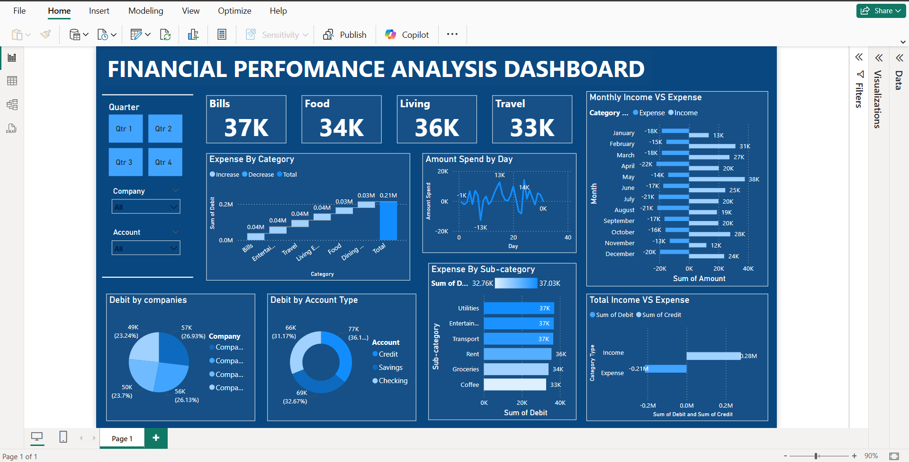

# Financial Performance Analysis Dashboard (Power BI)


An interactive Power BI dashboard that tracks a company's income and expenses across a full year. It shows where the money goes and how cash flow changes month by month.



---

## Business questions

1. Which expense categories and sub-categories cost the most?
2. How does spending vary day to day?
3. How do monthly income and expenses compare?
4. What is the overall gap between total income and total expenses?
5. Which account types and companies carry the most debit transactions?

## Key findings

- **Income of about 277K against expenses of about 213K** for the year, a net surplus of about 64K.
- Spending is **spread evenly across categories**. Bills (37K), Entertainment (37K), Travel (37K) and Living Expenses (36K) are all close, so there is no single cost to cut. Savings would need to come from several areas.
- At sub-category level, **Utilities, Entertainment and Transport** lead spending at about 37K each.
- Debits are **split almost evenly across the four companies and three account types** (credit, savings, checking).

## Dashboard features

- KPI cards for Bills, Food, Living and Travel
- Waterfall chart of expenses by category
- Daily spend trend
- Monthly income vs expense comparison
- Breakdown by sub-category, company and account type
- Slicers for quarter, company and account

## Data

[`Finance_Expenses.csv`](Finance_Expenses.csv) has 500 transactions dated January to December 2023. Its columns are account, date, company, debit, credit, amount, category, sub-category and type (income or expense). I cleaned and prepared it in Excel before loading it into Power BI.

## Files

```
├── Finance_Dashboard.pbix      Power BI report
├── Finance_Expenses.csv        Dataset
└── dashboard_screenshot.png
```

## Skills shown

Data cleaning in Excel · Power BI data modelling · KPI design · waterfall and comparison visuals · financial storytelling

---

**Rushikesh Patil** · [GitHub](https://github.com/RushikeshPatil-BA)
